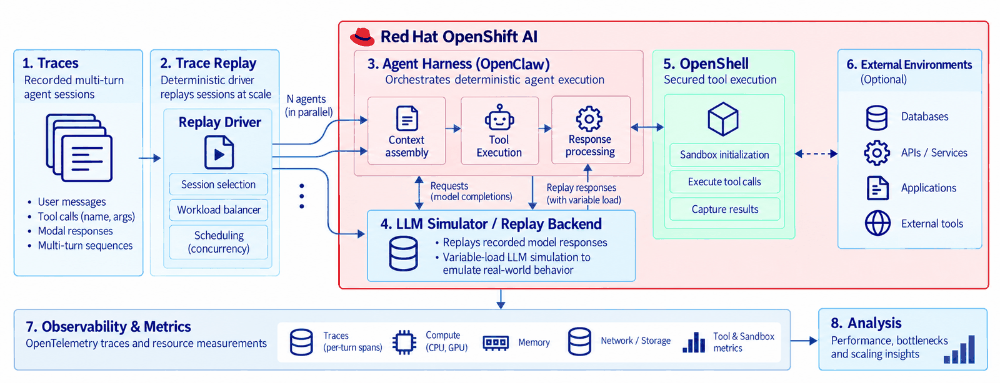

# Agentic Trace Replay Simulator

Want to benchmark your own agentic AI deployment? On different CPUs, with a
different harness, after an optimization, or as you scale from ten agents to a
hundred - and to the thousand you are planning. This tool replays recorded
agent sessions at the scale you choose and shows where the performance
bottlenecks actually are: the harness that assembles context, the sandbox that
runs tools, the services behind those tools, or the queue that forms when the
fleet runs at once.

Responses are replayed, not generated, so a run needs no GPU and no live
inference endpoint and repeats exactly: same traces, same pacing, same work.
That is what makes a before/after comparison mean something.

## How it works



Recorded multi-turn sessions go in. A replay driver spreads them across agents,
balances the workload mix, and schedules them at the concurrency you ask for.
Each agent then does its normal work - context assembly, tool decisions,
response processing against a simulator that returns the recorded response at
a configurable pace. Tool calls take the ordinary route into an OpenShell sandbox
and out to the workload backend or external service.

OpenTelemetry spans, CPU and memory samples, and tool and sandbox metrics are
correlated per turn, so the answer is "this stage, this much" rather than a
single end-to-end number.

Four workload classes are replayed with their behaviour intact:

| Workload | Backend | What it stresses |
| --- | --- | --- |
| `swe` software engineering | pinned SWE-bench repositories | long context, repeated execution, memory growth |
| `pa` personal assistant | AppWorld | interactive tool loops, application state |
| `research` deep search | BrowseCompPlus | variable tool depth, external waits |
| `cs` customer support | Tau2 | short transactions at high concurrency |

The three added backends are stateful replay environments, not official
benchmark score runs. The point is the platform cost around the work, not the
model's answer quality.

## Tuning a run

`scripts/bench` is the benchmark entrypoint. The knobs that matter:

| Flag | What it changes |
| --- | --- |
| `--agents N` | Fleet size, 1 to 100 agents in one run. |
| `--workload-dist DIST` | Mix: `even` (default), `swe`, `pa`, `research`, `cs`, `swe:60,pa:20,cs:20` (percent), or `swe=2,pa=1,research=1,cs=0` (counts). |
| `--traces N` | Traces per workload. Defaults to 1 on small fleets and scales with the agent count above 20. |
| `--session-ids IDS` | Run hand-picked sessions instead of the automatic selection. |
| `--warm-pool N` | Ready sandboxes available before the run starts. Defaults to one per agent. |
| `--cold-ratio R` | Share of agents forced through cold start, to price the warm pool against. |
| `--simulated-ttft MS`, `--simulated-itl MS` | Model pacing. Low values emulate a fast model and push the harness harder; high values emulate a slow one. |
| `--dispatch-interval SEC` | Spacing between trace admissions, to ramp load instead of starting flat out. |
| `--dry-run` | Print the plan, the session assignment, and the pacing without touching the cluster. |
| `--list-workloads`, `--list-sessions WL` | Inspect the registry and the sessions available in a corpus. |

`scripts/bench --help` has the full list, including retries, output directory, and
a set of worked examples.

## Running

You need an OpenShift AI cluster with a reachable OpenShell gateway, an agent
image available to it, a kubeconfig, and a replay corpus. `bench` itself needs
bash 4 or newer.

```bash
# once per checkout
python3 -m venv .venv && source .venv/bin/activate
pip install -e ".[dev]"

# once: build the replay corpus from recorded Exgentic traces
python -m trace_replay_sim ingest --out data/replay.json

# see what would run, without touching the cluster
./scripts/bench --agents 100 --corpus data/replay.json --dry-run

# run it
./scripts/bench --agents 100 --corpus data/replay.json
```

Common variations:

```bash
# software engineering only, 50 agents
./scripts/bench --agents 50 --workload-dist swe --corpus data/replay.json

# 80 ready sandboxes, the rest cold, to price readiness
./scripts/bench --agents 100 --warm-pool 80 --cold-ratio 0.2 --corpus data/replay.json

# fast model: 15 ms to first token, 5 ms between tokens
./scripts/bench --agents 100 --simulated-ttft 15 --simulated-itl 5 --corpus data/replay.json
```

`./run.sh` (or `scripts/run_experiment.sh`) is the same controller with the full
flag set instead of the benchmark shorthand: explicit per-workload plan, node
placement, storage class and access mode, gateway endpoint, and resume options.
Use `--plan` there for the non-mutating check.

Cluster settings are flags or `TRACE_REPLAY_*` variables: `TRACE_REPLAY_NODE`,
`TRACE_REPLAY_ALLOWED_NODES` (optional node allow-list, empty accepts any),
`TRACE_REPLAY_OPENCLAW_IMAGE`, `TRACE_REPLAY_OPENSHELL_GATEWAY_ENDPOINT`,
`TRACE_REPLAY_WORKSPACE_STORAGE_CLASS`, and `KUBECONFIG`.

## What you get

Each run writes per-turn and per-tool CSV and JSON, OpenTelemetry traces, cgroup
and Prometheus CPU/memory series, sandbox and tool timing, node and warm-pool
assignments, and the analysis plots.

Before requesting cluster access, `scripts/check_local_readiness.sh` runs the
same 100-agent queue-building path locally, without touching the cluster.

## Layout

```text
src/trace_replay_sim/   replay driver, simulator, harnesses, telemetry, analysis
scripts/                bench entrypoint, cluster controller, backends, gates
k8s/                    example manifests: mock LLM, backends, gateway, agents
config/                 backend manifest, SWE task manifest, AppWorld task map
docs/                   architecture diagram
tests/                  unit and integration tests
```

## Related

- [Opening the black box: Profiling a secured agentic pipeline on Red Hat OpenShift AI](https://www.redhat.com/en/blog/opening-black-box-profiling-secured-agentic-pipeline-red-hat-openshift-ai)
- [Red Hat OpenShift AI](https://www.redhat.com/en/technologies/cloud-computing/openshift/openshift-ai)
- [OpenShell](https://docs.nvidia.com/openshell/about/overview)
- [OpenClaw](https://openclaw.ai/)

Questions, or your own results to compare: the PSAP Agentic team.
